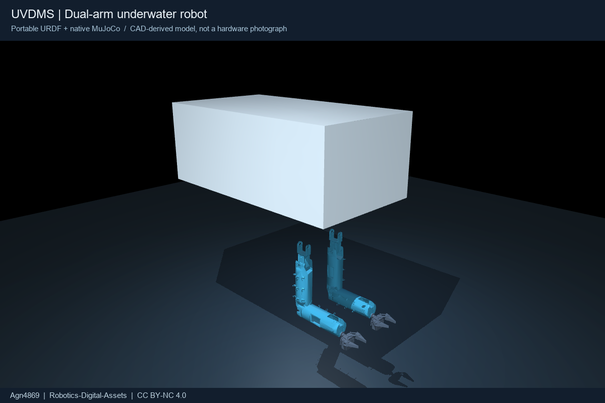
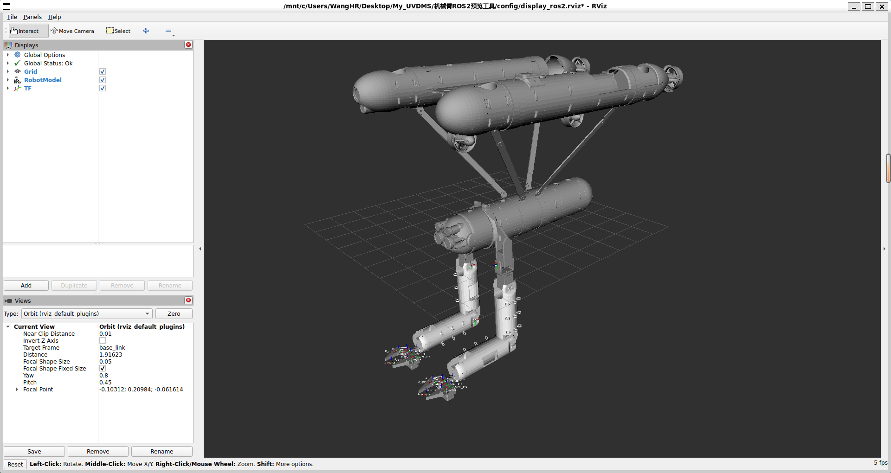
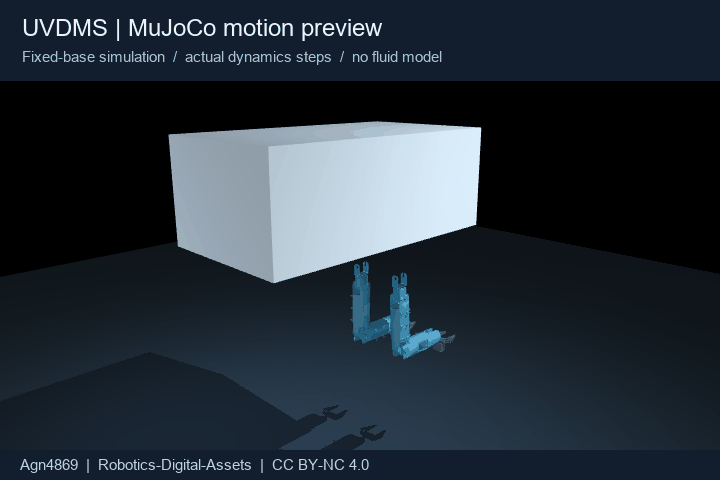
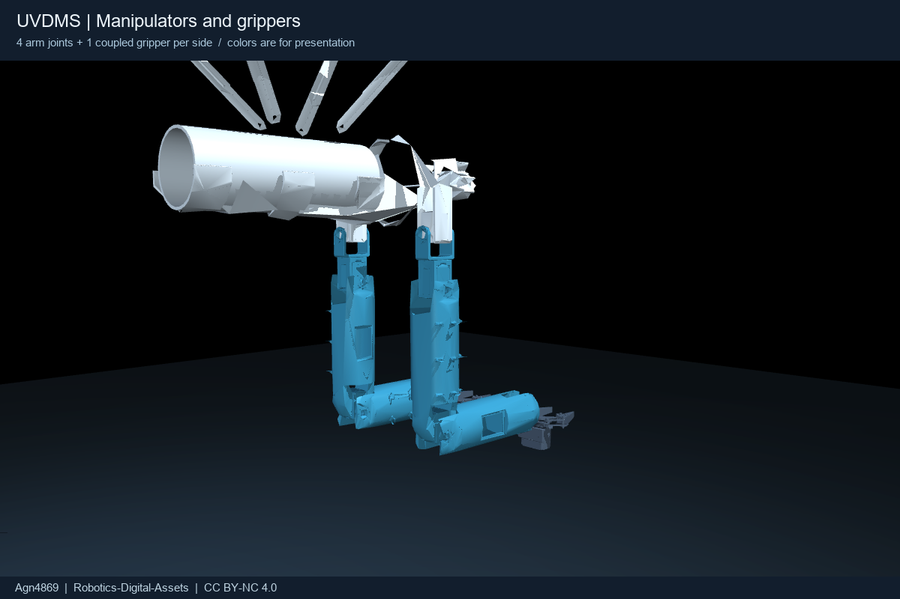

# Robotics-Digital-Assets

面向机器人研究的可复用数字资产：机器人模型、操作对象、仿真场景与物理参数参考。

**发布与维护：[Agn4869](https://github.com/Agn4869)** · [English](README.md) · [许可与署名](NOTICE.md) · [引用信息](CITATION.cff)




*RViz2展示完整艇体网格，适合查看CAD外形；这张图不是MuJoCo结果。*

## 第一套资产：UVDMS双臂水下机器人

这是一套三体水下航行器与双臂机械手的CAD衍生模型。每条机械臂有4个旋转关节和1个独立夹爪驱动，夹爪其他关节通过mimic关系联动。

本仓库将模型资产与 [UVMS-DriftManip](https://github.com/Agn4869/UVMS-DriftManip) 的研究代码分开发布：包含**可移植URDF、精简STL网格、原生MuJoCo模型、可运行示例、展示图和参数来源**。小型连杆/夹爪网格做了精简；完整艇体网格保留给URDF/RViz2查看。不需要原开发者的本地路径，也不需要安装ROS、Isaac Sim或SolidWorks。

**明确边界：这是可运行的机械模型，不是经过实艇标定的水下数字孪生。** 自由基座版本使用零重力，没有浮力、流体阻力、附加质量或推进器，不能把它当作水池仿真。

**为什么MuJoCo中的艇体外形不同：**原始艇体STL有 **1,535,636个三角面**，MuJoCo单个STL最多接受200,000个面。为了保证MuJoCo能加载，MuJoCo版本对艇体使用了明确标注的外形/碰撞代理；完整艇体仍在URDF/RViz2版本中。这是文件格式上限，不是原始网格错误。
## 环境交互资产

第二套资产是可复用的操作对象：**按钮、拨杆、滑块导轨、转盘阀门、面板和纹理面板**。它们以USD/USDA/USDC等格式整理，并保留上游许可证和来源信息。

➡️ **[查看环境资产说明](assets/environments/README.md)**

| 资产 | 典型交互 | 格式 |
|---|---|---|
| AM-Bench按钮 | 按下/释放 | USD |
| 拨杆 | 绕关节转动 | USD / USDA |
| 滑块导轨 | 直线滑动 | USD / USDA |
| 工业手轮 | 固定阀体、旋转手轮 | USDC / USDA |
| 面板 | 安装交互机构 | USDA + PBR纹理 |

这些文件是分别授权的上游资产或衍生资产，**不自动适用仓库根目录的CC BY-NC许可**。再分发前请查看[来源和署名说明](assets/environments/SOURCES.md)。



演示由MuJoCo实际步进生成，不是实艇录像、策略训练成果或抓取成功证明。配色用于展示，不代表实物材料或涂装。

## 快速运行

建议Python 3.10及以上，先使用已验证的MuJoCo 3.3.7版本。

```bash
git clone https://github.com/Agn4869/Robotics-Digital-Assets.git
cd Robotics-Digital-Assets
python -m venv .venv
```

Windows PowerShell激活环境：

```powershell
.venv\Scripts\Activate.ps1
```

Linux/macOS激活环境：

```bash
source .venv/bin/activate
```

安装并打开模型：

```bash
python -m pip install -r requirements.txt
python examples/preview.py --model fixed
```

- 默认缓慢驱动两臂和夹爪，**真实计算动力学**，不是直接设置关节位置。
- 手动调关节：`python examples/preview.py --model fixed --manual`，使用查看器右侧Control滑条；单位是弧度。
- 自由基座：`python examples/preview.py --model floating`，有真实free joint，但没有水动力。
- 无界面运行：`python examples/preview.py --model fixed --headless --seconds 5`。
- macOS图形查看器如需要主线程启动器，改用`mjpython examples/preview.py --model fixed`。
- 无显示器Linux服务器若需生成图片，要配置EGL/OSMesa等可用OpenGL后端；仅无界面动力学步进不需要渲染。

## 文件怎么用

| 文件/目录 | 用途 |
|---|---|
| `assets/uvdms/urdf/uvdms.urdf` | 通用URDF；网格使用相对路径，保持旁边的meshes目录 |
| `assets/uvdms/meshes/` | 精简网格，两个格式共享，不重复放原始大文件 |
| `assets/uvdms/mujoco/scene.xml` | 可直接加载的固定基座MuJoCo场景 |
| `assets/uvdms/mujoco/model.xml` | 原生固定基座机器人定义 |
| `assets/uvdms/mujoco/floating.xml` | 可直接加载的自由基座零重力示例 |
| [模型说明](assets/uvdms/README.md) | 关节名称、坐标、惯量、接触代理和已知限制 |
| `assets/uvdms/metadata.json` | 网格简化数量、哈希、质量与来源 |
| `assets/uvdms/physical_parameters.json` | 区分CAD、论文名义参数与假设的物理信息 |
| `docs/validation.json` | 本次运行验证结果；不等于实艇校准 |

URDF使用者需确认自己的导入器支持mimic；有些工具只显示关节，不执行联动。提供的MuJoCo版已将10个mimic关系转成关节等式约束，不会把20个铰链误作20个独立驱动器。



### 在Python里直接加载

在仓库根目录运行：

```python
from pathlib import Path
import mujoco

model = mujoco.MjModel.from_xml_path(
    str(Path("assets/uvdms/mujoco/scene.xml").resolve())
)
data = mujoco.MjData(model)
for _ in range(1000):
    mujoco.mj_step(model, data)
```

已有文件可直接使用，不需要重新转换。重新生成MuJoCo文件和展示图：

```bash
python -m pip install -r requirements-build.txt
python tools/build_mujoco.py
python examples/render_gallery.py
```

## 必须保留署名，资产不授予商用许可

- **模型、网格、文档和展示图片：CC BY-NC 4.0。** 公开分享模型或其修改版时，必须保留 **Agn4869** 署名、仓库链接、许可证与免责声明，并注明修改。
- **Python工具与示例：MIT。** MIT只适用于代码，不把模型资产变成可商用资产。
- 署名可放在README、模型卡、数据集说明、图注或视频简介中，采用与分享方式相适应的合理形式。
- 科研使用请在论文方法或致谢部分引用本仓库；[CITATION.cff](CITATION.cff)可供GitHub生成引用。
- 标准CC许可不能被说成“所有私人使用或所有不含本素材的研究结果都强制引用”；详细范围以[NOTICE.md](NOTICE.md)和[完整许可](LICENSE)为准。

可直接复制的署名：

> 本项目使用Agn4869发布的Robotics-Digital-Assets UVDMS资产：https://github.com/Agn4869/Robotics-Digital-Assets ，许可为CC BY-NC 4.0。修改：无。

如有修改，将“修改：无”换成实际内容。商业使用请另行联系维护者取得许可。

平台与物理背景参考：熊昕飏，《水下航行器-双臂机械手动力学耦合分析及协调控制》，华中科技大学博士学位论文，2025。本仓库不包含论文原页、论文截图、原始SolidWorks工程、训练数据或第三方任务场景。
