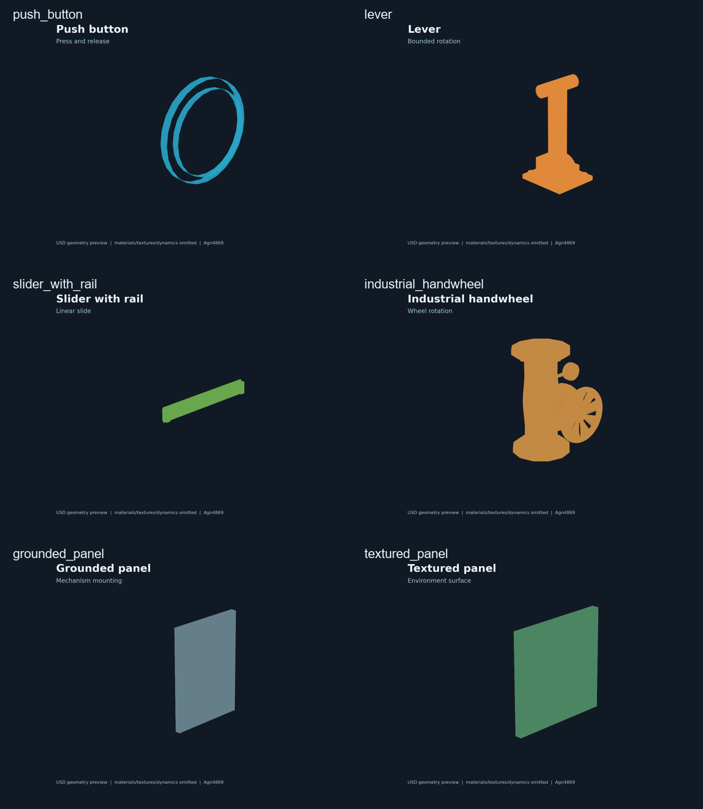

# Environment interaction assets

This directory contains reusable articulated environment objects for robot manipulation: push buttons, levers, sliders, panels and a wheel valve.

**No SolidWorks files are included.** No `.SLDASM`, `.SLDPRT`, CAD assembly, or private source project is redistributed here.

## Included assets

| Directory | Contents | Format | License / source |
|---|---|---|---|
| `ambench/` | `push_button.usd`, `lever.usd`, `slider_with_rail.usd`, `valve.usd` | USD | AM-Bench contributors, Apache-2.0 |
| `marine_mechanisms_v1/` | marine-looking `lever.usda`, `slider_with_rail.usda`, `grounded_panel.usda` | USDA | Appearance derivatives; original mechanisms retain AM-Bench notice |
| `industrial_handwheel/` | wheel valve, 2.5× scaled USDA, textures and provenance | USD/USDZ/USDA | WasserMan-derived Apache-2.0 module; underlying Poly Haven assets CC0-1.0 |
| `panels/ship_green/` | textured panel slab and PBR maps | USDA/JPG | Poly Haven `green_metal_rust`, CC0-1.0 |
| `valve_parts/` | three static valve-part URDF/STL exports | URDF/STL | User-supplied SolidWorks exports, root CC BY-NC-4.0 |
| `env_sldasm_export/` | two-revolute environment URDF/STL export | URDF/STL | User-supplied assembly export, root CC BY-NC-4.0 |

The USD files are kept in the relative layout expected by their references. Use a USD-capable viewer such as Isaac Sim, Omniverse/USD tooling, or `usdview` where available. These are environment assets, not a complete task scene and not a calibrated model of a commercial mechanism.

The individual preview images are linked from each asset-group README: [AM-Bench](ambench/README.md), [marine mechanisms](marine_mechanisms_v1/README.md), [industrial handwheel](industrial_handwheel/README.md), [textured panel](panels/ship_green/README.md), [valve parts](valve_parts/valve_1/README.md), and [two-revolute export](env_sldasm_export/README.md).

## Provenance and attribution

The source organization is [WasserMan](https://github.com/dancher00/wasserman), Apache License 2.0. It in turn identifies [AM-Bench](https://github.com/ambench/ambench) as the source for the mechanism assets and [Poly Haven Modular Industrial Pipes 01](https://polyhaven.com/a/modular_industrial_pipes_01) / `green_metal_rust` for CC0 visual materials.

The original notices and licenses are kept next to each asset. See [`manifest.json`](manifest.json) for source paths, upstream commit references, hashes and whether an asset is an unmodified copy or an appearance derivative.

Suggested attribution when sharing this environment bundle:

> Environment interaction assets from Robotics-Digital-Assets by Agn4869, https://github.com/Agn4869/Robotics-Digital-Assets. AM-Bench-derived objects retain their Apache-2.0 notices; WasserMan-derived adaptations retain WasserMan/AM-Bench attribution; Poly Haven materials are CC0-1.0. Changes: state your changes here.

This repository's **Agn4869 attribution is required for the bundle and its original curation/documentation** under the repository policy. It does not replace upstream attribution or change the license of upstream files. Commercial use of the UVDMS assets and this bundle's original curation is not granted by the root CC BY-NC license; upstream Apache-2.0 and CC0 files retain their own terms.

## Physics boundary

The authored mass, friction, damping and travel values are simulation assumptions from the upstream asset packages. They are not measurements of real buttons, valves or underwater mechanisms. Do not use them as hardware ratings, contact-force limits or safety specifications without calibration.

This release intentionally excludes the local Isaac Sim task scenes because those scenes also reference the private robot workspace and are not portable on their own. The object files can be composed into new scenes using the relative references documented above.

## 中文说明

这里整理了可复用的机器人环境交互对象：按钮、拨杆、滑块导轨、工业手轮、接地面板、纹理面板、三个静态阀件和一个双旋转关节环境机构。

| 目录 | 内容 | 格式 |
|---|---|---|
| `ambench/` | AM-Bench按钮、拨杆、滑块、阀门 | USD |
| `marine_mechanisms_v1/` | 海洋风格拨杆、滑块和接地面板衍生版本 | USDA |
| `industrial_handwheel/` | 工业手轮、纹理和来源信息 | USDC / USDA |
| `panels/ship_green/` | 纹理面板和PBR贴图 | USDA / JPG |
| `valve_parts/` | 一号阀、二号阀件、T型阀的静态导出 | URDF / STL |
| `env_sldasm_export/` | 两个revolute关节的环境导出 | URDF / STL |

每个资产组的 `README.md` 都包含中英文说明和对应预览图。USD资产预览基于USD几何数据，阀件/URDF资产预览基于URDF和STL几何；所有预览都省略材质、纹理和动力学，不等同于Isaac Sim的最终渲染。

**不会包含任何 SolidWorks 文件**，也不会上传 `.SLDASM`、`.SLDPRT` 或私有任务场景。再分发前请阅读各目录的 `NOTICE.md`、`LICENSE.txt`、[SOURCES.md](SOURCES.md) 和 [manifest.json](manifest.json)。上游 Apache-2.0 与 CC0-1.0 文件不自动适用仓库根目录的 CC BY-NC 许可。
