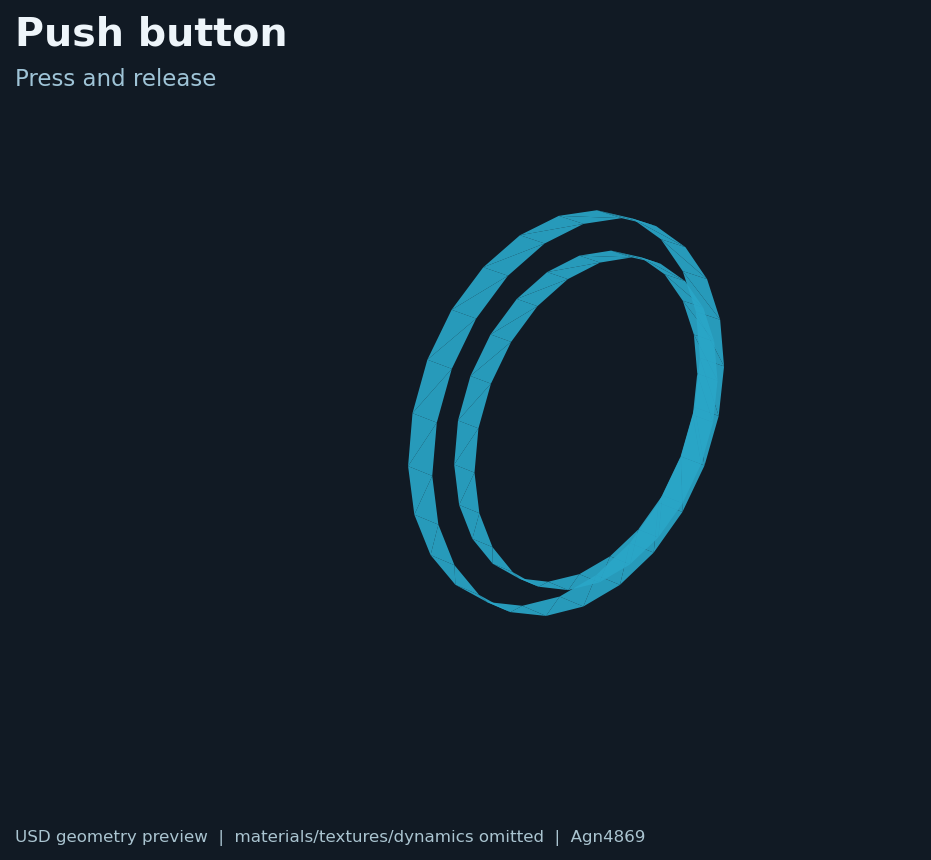

# AM-Bench interaction objects

## English

Unmodified AM-Bench USD objects redistributed with the upstream Apache-2.0 notice: `push_button.usd`, `lever.usd`, `slider_with_rail.usd`, and `valve.usd`.

The preview is a lightweight USD geometry preview; materials, textures and dynamics are omitted. Source and license: [NOTICE-upstream.md](NOTICE-upstream.md), [LICENSE.txt](LICENSE.txt), and the [environment guide](../README.md).

## 中文

这里是从 AM-Bench 保留的未修改 USD 交互对象：`push_button.usd`、`lever.usd`、`slider_with_rail.usd` 和 `valve.usd`。文件遵循上游 Apache-2.0 许可。

上图是轻量 USD 几何预览，不包含材质、纹理和动力学效果。来源与许可证见 [NOTICE-upstream.md](NOTICE-upstream.md)、[LICENSE.txt](LICENSE.txt) 以及[环境资产总说明](../README.md)。
