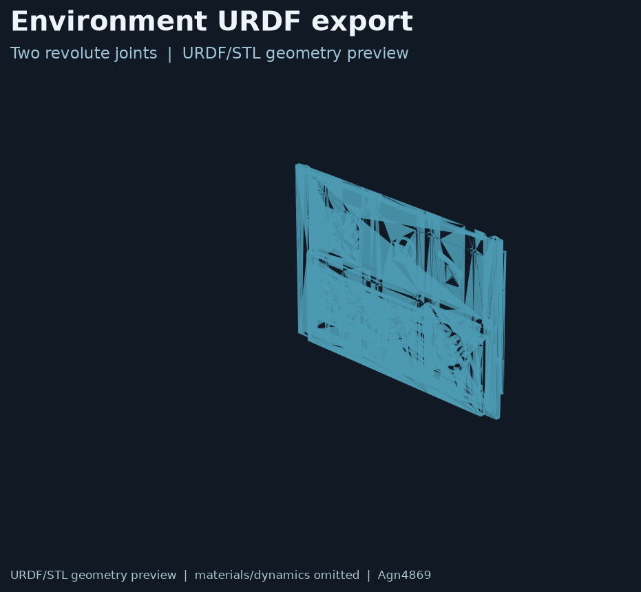

# Exported interaction assembly

## English

This directory is a cleaned, portable export of the user-provided `env.SLDASM` workspace. It is **not the original SolidWorks assembly**: no `.SLDASM`, `.SLDPRT`, SolidWorks history, export log or private launch configuration is included.

Contents:

- `urdf/env.urdf` — three-link interaction object;
- `meshes/base_link.STL`, `link1.STL`, `link2.STL` — exported geometry;
- `config/joint_names.yaml` — both movable joint names.

The object has two revolute joints:

| Joint | Type | Axis in joint frame | Notes |
|---|---|---|---|
| `joint1` | revolute | `[0, 1, 0]` | exported continuous joint; converted to explicit ±π limits |
| `joint2` | revolute | `[0, 0, 1]` | reconstructed from the joint coordinate frame because the export CSV omitted `Axis_joint2`; verify against the CAD assembly before dynamics use |

The URDF export originally marked `joint2` as fixed and emitted a zero axis. That export error has been corrected in this portable copy based on the maintainer's confirmation that both mechanisms rotate. The second axis is the remaining CAD-validation item.

The image is a lightweight URDF/STL geometry preview. It omits material, texture, contact and dynamics calibration.

## 中文

这里是用户提供的 `env.SLDASM` 导出工作区的干净、可移植版本。**不是原始SolidWorks装配文件**：没有上传 `.SLDASM`、`.SLDPRT`、SolidWorks历史、导出日志或私有启动配置。

包含：

- `urdf/env.urdf`：三连杆交互对象；
- `meshes/base_link.STL`、`link1.STL`、`link2.STL`：导出网格；
- `config/joint_names.yaml`：两个可动关节名称。

这个对象有两个旋转关节：

| 关节 | 类型 | 关节坐标系轴 | 说明 |
|---|---|---|---|
| `joint1` | revolute | `[0, 1, 0]` | 原导出为continuous，整理版改为显式±π范围 |
| `joint2` | revolute | `[0, 0, 1]` | 导出CSV没有提供`Axis_joint2`，根据关节坐标系暂时重建；用于动力学前需再和CAD核对 |

原URDF把 `joint2` 错误标成了 fixed，并且轴为零。根据维护者确认两个机构都能旋转，整理版已修正；第二个关节轴仍需CAD最终确认。

上图是轻量URDF/STL几何预览，不包含材质、纹理、接触和动力学标定。

## License / 许可

This exported asset is released with the repository's CC BY-NC 4.0 asset policy. Preserve Agn4869 attribution and repository URL when sharing it. It is an exported model, not a certified hardware mechanism.

该导出资产遵循仓库的CC BY-NC 4.0资产政策。分享时请保留Agn4869署名和仓库链接。它是导出模型，不是经过认证的真实机构。
