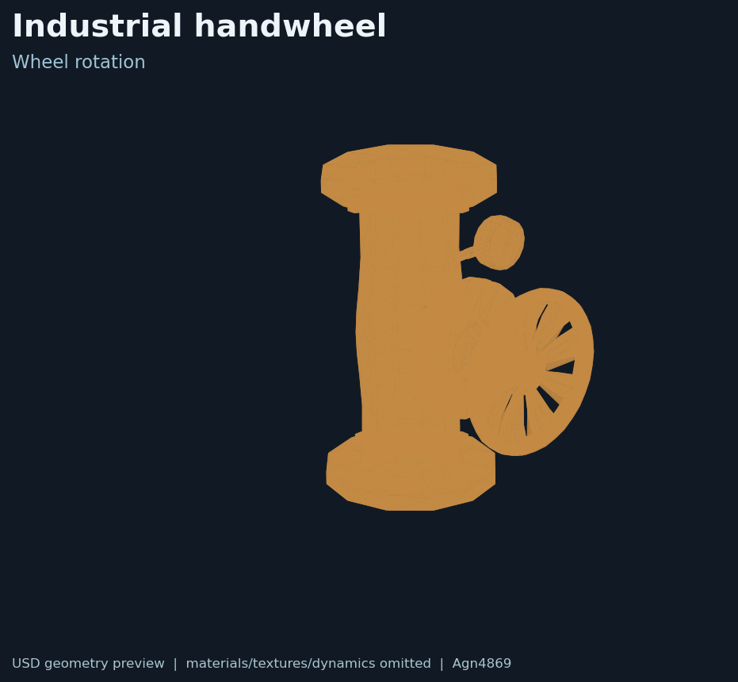

# Industrial handwheel

## English

WasserMan-derived industrial wheel valve with the packaged 2.5× USDA variant, source USDC, textures and provenance. The wheel and body are separate articulated parts in the USD asset. Physics values are upstream simulation assumptions, not hardware measurements.

Source details: [NOTICE.md](NOTICE.md), [provenance.json](provenance.json), [LICENSE-wasserman-apache-2.0.txt](LICENSE-wasserman-apache-2.0.txt), and the [environment guide](../README.md).

## 中文

这里是 WasserMan 衍生的工业手轮阀门资产，包含2.5倍 USDA版本、源 USDC、纹理和来源信息。USD中阀体与手轮是分开的关节部件。物理参数只是上游仿真假设，不是硬件实测值。

来源详情见 [NOTICE.md](NOTICE.md)、[provenance.json](provenance.json)、[LICENSE-wasserman-apache-2.0.txt](LICENSE-wasserman-apache-2.0.txt) 和[环境资产总说明](../README.md)。
