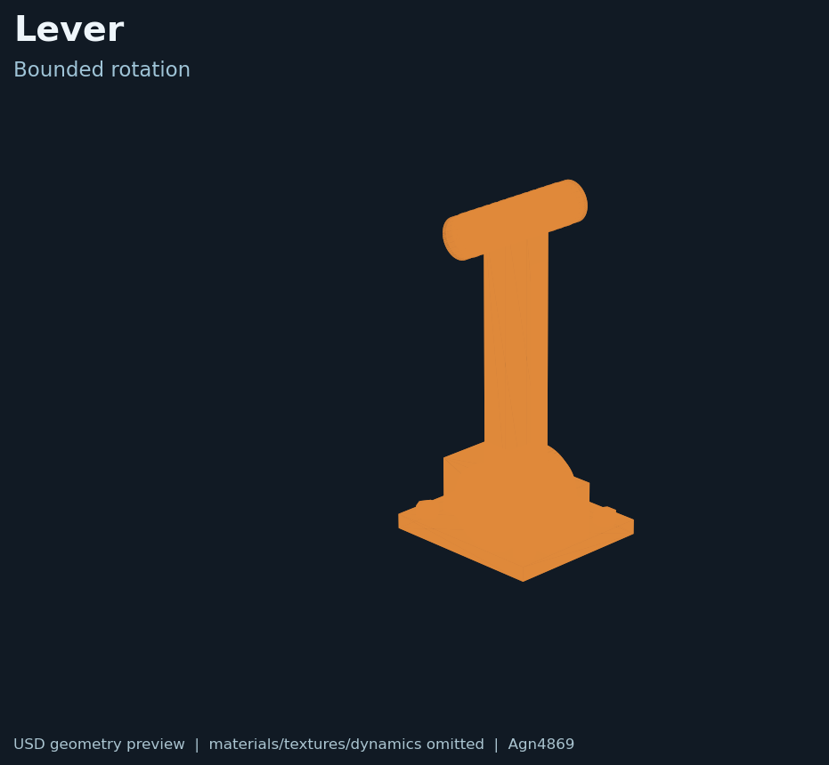
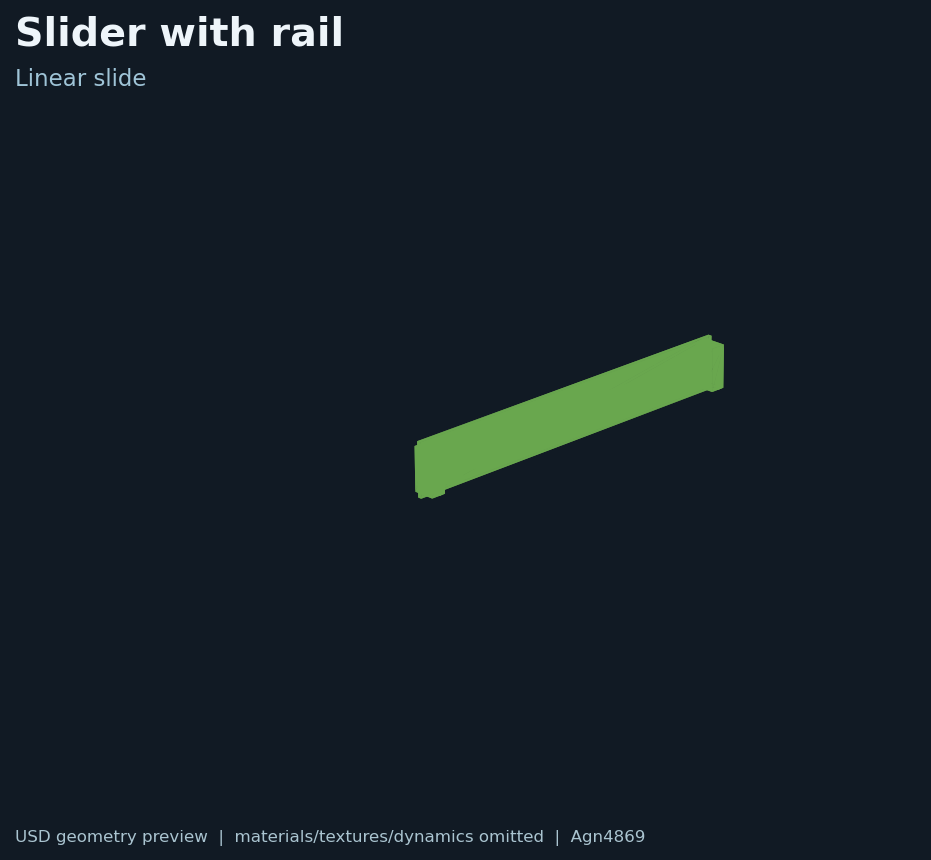
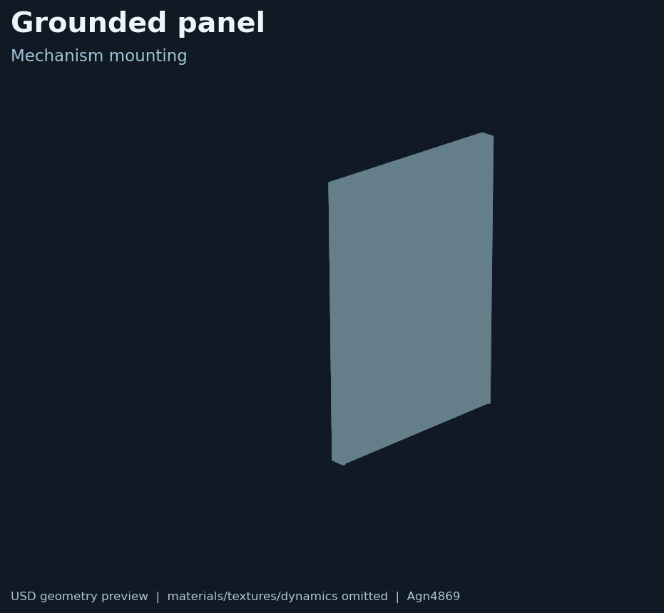

# Marine mechanism derivatives

## English

WasserMan-derived marine-style appearance variants of the lever and slider, plus a grounded panel composition. The upstream mechanism definitions and notices are retained; these are not manufacturer CAD or calibrated hardware.

See [manifest.json](manifest.json), [NOTICE.md](NOTICE.md), [LICENSE.txt](LICENSE.txt), and the [environment guide](../README.md).

## 中文

这里是 WasserMan 风格的海洋环境外观衍生资产，包括拨杆、滑块导轨和接地面板。上游机构定义和许可证已保留；这些文件不是厂商 CAD，也没有经过真实硬件标定。

请查看 [manifest.json](manifest.json)、[NOTICE.md](NOTICE.md)、[LICENSE.txt](LICENSE.txt) 和[环境资产总说明](../README.md)。
