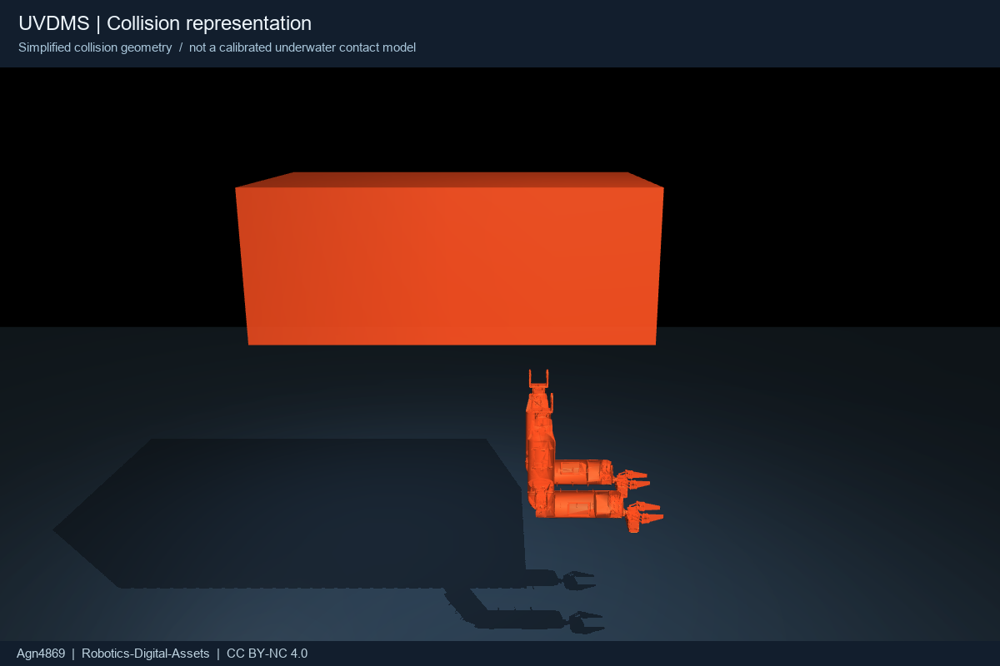

# UVDMS asset card

[Repository overview](../../README.md) · [中文快速开始](../../README.zh-CN.md) · [License and attribution](../../NOTICE.md)

## Model identity

CAD-derived three-hull underwater vehicle with two manipulators. Packaged from the corrected UVDMS URDF used by UVMS-DriftManip; visuals are reduced SolidWorks-exported STL meshes. Model filenames, SI units, source joint transforms and explicit inertias are retained. No original SolidWorks assemblies, thesis images or third-party tasks are included.

| Property | Released mechanical model |
|---|---|
| Source links / joints | 25 / 24 (including 2 massless TCP frames and 4 fixed joints) |
| Hinges / independent controls | 20 / 10 |
| Per arm | `joint_1A`…`joint_4A`, and corresponding `B` names |
| Gripper master controls | `A_gripper_right_D`, `B_gripper_right_D` |
| Gripper dependent hinges | 5 per side, represented by 10 MuJoCo joint equalities |
| Total CAD-derived mass | 33.27295122 kg |
| Hull mass / COM in base axes | 29.878 kg / `[-0.21133, 0.0021801, 0.33464]` m |
| Base axes | x forward, y port/left, z up; origin is not COM |
| TCPs | `A_gripper_tcp`, `B_gripper_tcp`; estimated local x offset 0.115 m |
| Native MuJoCo files | fixed `model.xml`, fixed scene `scene.xml`, free-base `floating.xml` |

The released hull tensor includes the corrected thesis product-of-inertia conversion: `ixy=-0.01, ixz=-0.08, iyz=+0.03 kg m²`. The historical thesis lists products, while its Eq.2.59 negates these into tensor elements before rotating axes. This correction does not establish that the historical hull tensor exactly matches the current CAD assembly.

## Loading and controlling

```python
import mujoco
model = mujoco.MjModel.from_xml_path("assets/uvdms/mujoco/scene.xml")
data = mujoco.MjData(model)
actuator = mujoco.mj_name2id(model, mujoco.mjtObj.mjOBJ_ACTUATOR, "joint_2A")
data.ctrl[actuator] = 0.1  # target angle in radians
for _ in range(2000):
    mujoco.mj_step(model, data)
```

Actuator names match the ten independent joint names. Read `actuator_ctrlrange` rather than hard-coding indices. Gripper angle is a master hinge angle, **not jaw opening in metres**. Positive/negative angle changes follow the source URDF geometry and axis definitions. Follower hinges are constrained, not independently actuated. Their affine mimic relationships approximate the source linkage; this is not an exact flexible/four-bar gripper model.

The fixed scene mounts `base_link` at world z=1.2 m and applies gravity −9.81 m/s². The floating file adds a true six-DOF free joint and sets gravity to zero, without buoyancy compensation, drag, current, thrust or added mass. A zero-gravity free body is deliberately not advertised as an underwater physics model.

## Collision geometry



- Detailed visual meshes: group 2, noncolliding.
- Collision proxies: group 3, normally transparent and hidden in the example viewer.
- Hull: upper-hull box, local centre `[-0.2585,0,0.355]`, half-extents `[0.5885,0.3225,0.225]` m. The lower open frame is omitted; a single hull convex envelope would incorrectly fill the arm workspace.
- Arms and fingers: per-link convex mesh contacts, not exact concave CAD contact surfaces.
- Same-claw internal pairs and adjacent/welded groups are excluded to avoid conflicting internal collisions in the affine linkage approximation. **External finger contacts remain enabled.**
- Floor: group 0. TCP markers: group 4.

These proxies are appropriate for mechanical inspection and initial experiments, not validated grasp forces, exact clearances or collision-free path guarantees. URDF retains its mesh collision geometry; other simulators may approximate these surfaces differently.

## Numerical and control assumptions

| Setting | Value / interpretation |
|---|---|
| Integrator / step | `implicitfast`, 0.0005 s |
| Solver | Newton, 100 iterations, tolerance 1e−10 |
| Arm position servos | kp=80, kv=8; joint damping=0.3, armature=0.01 |
| Gripper position servos | kp=4, kv=0.08; hinge damping=0.02, armature=0.0002 |
| Actuator bounds | ±source URDF effort; 10 N·m, **not a measured hardware rating** |
| Mimic softness | `solref="0.003 1"`, `solimp="0.95 0.99 0.001"` |
| Contact friction | `0.7 0.01 0.001`, uncalibrated |

Finite gains, gravity and soft equality constraints produce nonzero tracking/mimic error. The viewer prints these errors rather than teleporting joints to hide them. Controller settings are for this demonstration, not instructions for physical hardware.

## Provenance, physical references and limits

`metadata.json` records source/generated mesh hashes, triangle counts and bounds. The complete hull STL has **1,535,636 triangles** and is retained for the URDF/RViz2 path. MuJoCo cannot accept a single STL above 200,000 faces, so its native model intentionally omits that detailed hull mesh and uses the documented visual/collision box proxy. Other meshes request up to 6,000 triangles. Simplification does not recompute mass/inertia or prove watertight, collision or manufacturing accuracy.

[physical_parameters.json](physical_parameters.json) separates historical nominal hydrodynamic coefficients from the current CAD description. The fluid coefficients are references only and are **not applied by these MJCF models**. Background source: 熊昕飏, *水下航行器-双臂机械手动力学耦合分析及协调控制*, HUST doctoral dissertation, 2025, especially Table3.1 and Eq.2.59–2.61.

Known unresolved real-platform differences:

The hull is intentionally preserved at source STL resolution in the URDF release. The source hull is a disconnected CAD assembly; treating it as one graph during decimation produced floating visual shards. MuJoCo therefore uses a proxy while RViz2/URDF keeps the complete authorized hull mesh. This increases download size but keeps the complete CAD view faithful. `metadata.json` records the policy and hashes.
- Current assembly mass, buoyancy, COM/COB, joint zero directions, hard limits and continuous actuator ratings need hardware confirmation.
- Grip friction, compliance, slip force, contact sensing and linkage backlash are not calibrated.
- TCP offset and gripper mounting clocking are estimates; no calibrated camera model is supplied.
- Thesis nominal values and simulated input saturation are not measurements of the present robot.
- No thruster dynamics, fluid simulation, task controller, policy weights or real-world success claims are included.

See [release validation](../../docs/validation.json) for the checks actually exercised. Asset quality reports and corrections are welcome through GitHub issues; include model version and a minimal reproduction.

## Credit

When sharing this model or a modified version, preserve **Agn4869**, https://github.com/Agn4869/Robotics-Digital-Assets, CC BY-NC 4.0 and change notices. See [NOTICE.md](../../NOTICE.md). This asset release credits the original platform and thesis separately; the curator attribution does not claim sole authorship of the physical robot.
